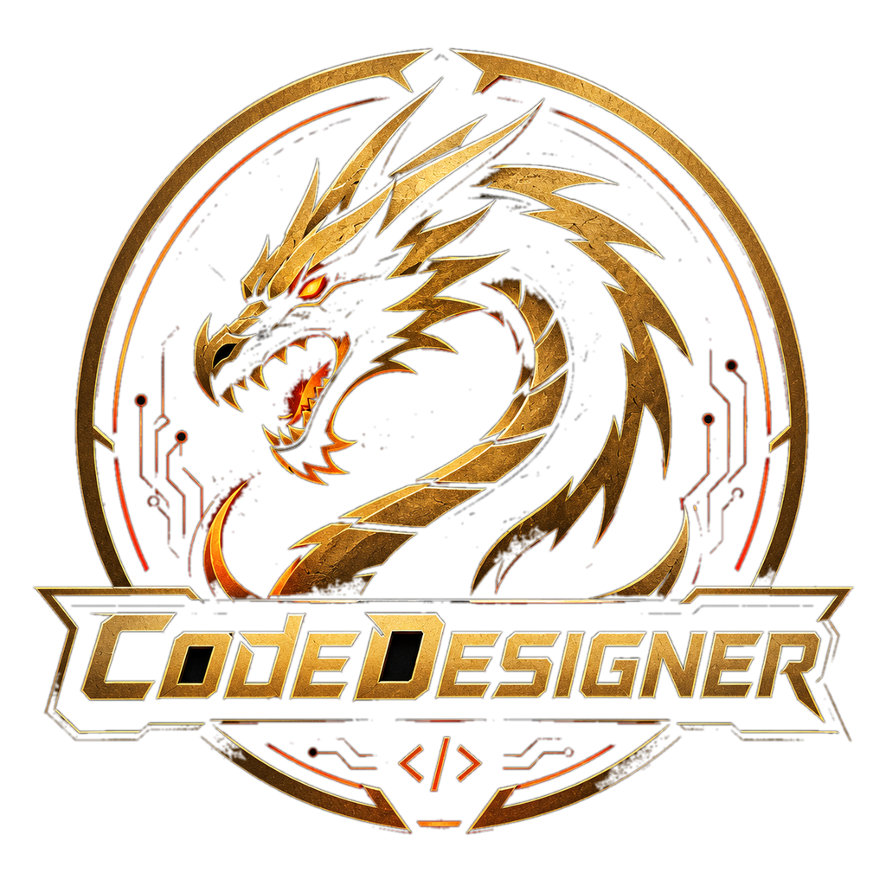

<p align="center">
  
  &nbsp;&nbsp;&nbsp;
  
</p>

<h1 align="center">PCSX2, CodeDesigner fork</h1>

<p align="center">
  PCSX2 with a debugger, controller, network, picture and sound interface added to its PINE socket, for use with
  <a href="https://github.com/FatalityDevelopment/CodeDesignerPS2">CodeDesigner PS2</a>.
</p>

---

This is a fork of [PCSX2](https://github.com/PCSX2/pcsx2), the PlayStation 2 emulator. It is not an official PCSX2 build and the PCSX2 team does not support it. For help with using PCSX2 itself (BIOS, game settings, compatibility), use the upstream project and [pcsx2.net](https://pcsx2.net).

The fork exists so that CodeDesigner can debug a game while it runs. Stock PCSX2 can already read and write memory over PINE. The fork adds everything else a debugger needs, and it leaves the emulation itself alone. This README covers what was changed and how to build it. Upstream's own documentation is not repeated here.

PCSX2 is licensed under GPL-3.0 or later (see `COPYING.GPLv3`), and so are the changes in this fork.

## What changed

Every change is in one of three areas. All of it sits on top of upstream's PINE code, and nothing else in the emulator was modified.

### 1. PINE debugger opcodes (0x10 to 0x46)

PINE is PCSX2's local IPC socket. Upstream defines opcodes `0x00` to `0x0F`. The fork adds 55 more, `0x10` to `0x46`, so no existing opcode changes meaning and clients that only use stock PINE are unaffected. The default PINE slot is still `28011`.

| Opcodes | What they do |
|---|---|
| `0x10`–`0x16` | Execution control: read PC, pause, resume, single-step, set and clear PC breakpoints |
| `0x17`–`0x19` | Read all EE registers at once, or read and write one register on either CPU |
| `0x1A`–`0x1D` | List EE threads, IOP threads and IOP modules; walk the EE call stack |
| `0x1E`–`0x21` | Step into, over and out; look up a function symbol by address |
| `0x22`–`0x27` | Save and load a state to a named file, reset, advance N frames, read FPS, set the speed limiter |
| `0x28`–`0x29` | List breakpoints; disassemble a range on the EE or IOP |
| `0x2A`–`0x2D` | Paged lists of function symbols and globals; look up a symbol by name; locals and parameters of a function |
| `0x2E`–`0x31` | Memory watchpoints that break on read, write or both |
| `0x32` | Save a screenshot |
| `0x33`–`0x37` | Read the pad state, set one button, set the analog sticks, set the whole pad at once, query the controller type |
| `0x38`–`0x3F` | DEV9 network bridge (see below) |
| `0x40`–`0x42` | Report on the GS stream server (see below) |
| `0x43`–`0x44` | Batched memory read and write: many EE or IOP addresses in one request |
| `0x45`–`0x46` | Mute or unmute audio (the same as the Toggle Mute hotkey), and query the mute state |

Every opcode, with its request and reply layout, is documented in [docs/pine-debugger-extension.md](docs/pine-debugger-extension.md). The wire format of the batch opcodes is in `pcsx2_pine_readmembatch_design.md`, in the `docs/` folder of the CodeDesigner PS2 repository.

### 2. GS stream server (live picture)

`pcsx2/GSStreamServer.cpp` and `.h` are new. They stream the game's picture to any connected client as MJPEG, so CodeDesigner's Preview window can show the running game.

- It is a push-only TCP server with its own thread and socket, so a frame can never hold up PINE requests.
- It starts and stops with PINE, and it only starts if PINE itself started. The port is chosen by the operating system. A client finds it with PINE opcode `0x40`, and opcode `0x41` reports the frames delivered and dropped and the number of subscribers.
- Each frame is a JPEG downscaled to 640x480, about 30 KB. Frames are only produced while at least one client is connected. A one-line hook in `GSRenderer.cpp` does the work once per vsync.
- Each message is a little-endian header (size, message type, frame index, width, height, codec, flags) followed by the JPEG. The exact layout is in the comment at the top of `GSStreamServer.h`.

### 3. DEV9 network capture and injection

`pcsx2/DEV9/NetCapture.cpp` and `.h` are new, and `DEV9/net.cpp` and `net.h` were extended. They let a client watch and inject the PS2's network traffic, which is how CodeDesigner labels SOCOM II's online messages.

- Capture records frames in both directions into a queue, with a filter by protocol, port or IP address. A client drains the queue, and can ask for a packet to be dissected into text.
- A client can inject a raw Ethernet frame into the PS2's receive FIFO, or send one out through the network adapter as if the PS2 had sent it.
- A client can query the adapter: whether it is enabled, its type, the PS2's MAC address and the last IP address seen. It can also read the transmit and receive counters.

### Files touched

| File | Change |
|---|---|
| `pcsx2/PINE.cpp` | All the new opcodes |
| `pcsx2/GSStreamServer.cpp`, `.h` | New: the GS stream server |
| `pcsx2/GS/Renderers/Common/GSRenderer.cpp` | Hands a downscaled frame to the stream server each vsync, when someone is listening |
| `pcsx2/VMManager.cpp` | Starts and stops the GS stream server with PINE |
| `pcsx2/DEV9/NetCapture.cpp`, `.h` | New: the capture queue and packet dissector |
| `pcsx2/DEV9/net.cpp`, `.h` | Capture taps on receive and transmit, adapter status, frame injection |
| `pcsx2/CMakeLists.txt`, `pcsx2/pcsx2.vcxproj`, `pcsx2.vcxproj.filters` | Register the new source files |
| `docs/pine-debugger-extension.md` | The protocol documentation |

The fork's own commits start in March 2026. Everything before that is upstream PCSX2's history, which this repository carries in full.

## Building

PCSX2 does not use git submodules for its libraries. The libraries reach a build in three other ways, described below, and only the first step needs a network connection.

### Submodules

There are two levels, and they are easy to mix up.

**This repository has no submodules.** Its `.gitmodules` file is empty and it contains no submodule entries, so there is nothing to run `git submodule update` for. Its third-party code comes from three places:

| Where | What | In git? |
|---|---|---|
| `3rdparty/` | Libraries whose source is checked in: Dear ImGui, fmt, cubeb, rcheevos, SoundTouch, libchdr, libzip, Zydis, VIXL, xbyak, glad, the Vulkan headers, GoogleTest and others | Yes |
| `deps/` | Libraries built from source by a script: Qt, SDL3, FFmpeg, shaderc and the image and compression libraries | No, git-ignored |
| `bin/resources/patches.zip` | PCSX2's game patch collection, downloaded from the `pcsx2_patches` project | No, git-ignored |

**This repository is itself a submodule of CodeDesigner PS2.** The CodeDesigner PS2 repository has two submodules:

| Path | Repository |
|---|---|
| `pcsx2` | `FatalityDevelopment/pcsx2` (this repository) |
| `CheatCodeArchive` | `FatalityDevelopment/CheatCodeArchive` |

A submodule is pinned to one exact commit, and CodeDesigner PS2 records which commit of this fork it uses. To get this fork as part of CodeDesigner, clone with submodules:

```bash
git clone --recurse-submodules https://github.com/FatalityDevelopment/CodeDesignerPS2.git
```

If you cloned without them, run this in the CodeDesigner PS2 folder:

```bash
git submodule update --init --recursive
```

That leaves `pcsx2/` on the pinned commit, in a detached HEAD state. To work on the fork from there:

```bash
cd pcsx2
git switch master            # leave the detached HEAD before committing
# ...change, commit, push...
cd ..
git add pcsx2                # record the new commit in CodeDesigner PS2
git commit -m "Update the PCSX2 fork"
```

Pushing the fork is not enough. CodeDesigner PS2 keeps using the old commit until the parent repository commits the new pointer.

To build the fork on its own, clone it directly:

```bash
git clone https://github.com/FatalityDevelopment/pcsx2.git
```

### Windows

**You need:**

- Visual Studio 2022 (17.x) with the *Desktop development with C++* workload. The dependency script also accepts Visual Studio 2026 (18.x), but it prefers 2022 when both are installed.
- The *C++ Clang tools for Windows* component. CodeDesigner's CI builds with `clang-cl`, and the solution has Clang configurations.
- [Git for Windows](https://git-scm.com/download/win) in its default folder. The dependency script runs the `patch` and `bash` that come with it.
- [7-Zip](https://www.7-zip.org/) installed at `C:\Program Files\7-Zip\7z.exe`.
- CMake and Ninja on your `PATH`. The dependency script uses them for the libraries it builds.
- A game BIOS dump from your own console. PCSX2 does not include one.
- Only for the optional FFmpeg step: Python, and NASM if you want FFmpeg built with assembly (without NASM the script falls back to C code and patches FFmpeg to match). FFmpeg also does not build in a path that contains spaces.

**1. Build the dependencies.** From the root of this repository, in a normal Command Prompt:

```bat
.github\workflows\scripts\windows\build-dependencies.bat
```

The script finds Visual Studio itself and sets up the compiler environment. It downloads each library's source from its project's site, checks every download against a pinned SHA-256 hash, builds it, and installs it into a new `deps\` folder at the root of this repository. Intermediate files go into `deps-build\`, which is also git-ignored.

It builds Qt 6.11 from source (qtbase, image formats, SVG, tools, translations, plus QtApng), SDL3, KDDockWidgets, FreeType, HarfBuzz, libpng with APNG support, libjpeg-turbo, libwebp, lz4, zlib, zstd, plutovg and plutosvg, rapidyaml, shaderc with its pinned glslang and SPIR-V sources, and the Direct3D 12 Agility SDK. Building Qt from source makes the first run long. After that `deps\` is reused, so you only run the script again when it changes.

Two environment variables change what it builds:

| Variable | Default | Effect |
|---|---|---|
| `DEBUG` | `1` | Build debug and release libraries. Set to `0` for release only. |
| `BUILD_FFMPEG` | `0` | Also build FFmpeg 8.1 and its codecs (x264, Opus, SVT-AV1 and the hardware encoder headers). |

For example, to match what CodeDesigner's CI does:

```bat
set DEBUG=0
set BUILD_FFMPEG=1
.github\workflows\scripts\windows\build-dependencies.bat
```

**2. Download the game patches.** The CI does this before every build:

```bat
cd bin\resources
curl -L -O https://github.com/PCSX2/pcsx2_patches/releases/latest/download/patches.zip
cd ..\..
```

**3. Build PCSX2.** Open `PCSX2_qt.sln` in Visual Studio, pick a configuration and build the `pcsx2-qt` project. Or build from a Visual Studio command prompt:

```bat
msbuild PCSX2_qt.sln /m /v:m /p:Configuration="Release AVX2" /p:Platform=x64
msbuild PCSX2_qt.sln /m /v:m /p:Configuration=Debug /p:Platform=x64
```

The solution has `Debug`, `Devel` and `Release` configurations, each with a `Clang` variant and an `AVX2` variant (for example `Release Clang AVX2`), for both x64 and ARM64. The executable is written to `bin\`; the Debug build is `bin\pcsx2-qtx64-dbg.exe`.

CodeDesigner's CI first writes a `Directory.build.props` file that points MSBuild at the `clang-cl` it finds on the machine. See the `build-pcsx2` job in the CodeDesigner PS2 repository's `.github/workflows/build.yml` for the exact step. That file is not git-ignored, so do not commit it.

**4. Turn PINE on.** In PCSX2, open *Settings → Advanced* and tick *Enable PINE*. The slot is `28011` unless you change it. CodeDesigner connects to that slot, and the GS stream server starts with it.

### Linux and macOS

The scripts for these platforms come from upstream and work the same way: one script builds the dependencies into a folder you choose, and CMake is pointed at that folder.

```bash
# Linux
.github/workflows/scripts/linux/build-dependencies-qt.sh "$HOME/deps"
cmake -B build -G Ninja -DCMAKE_BUILD_TYPE=Release -DCMAKE_PREFIX_PATH="$HOME/deps"
cmake --build build
```

On macOS, use `.github/workflows/scripts/macos/build-dependencies.sh` instead. `.github/workflows/linux_build_qt.yml` shows the full set of flags upstream's CI uses (clang 17 with lld and ccache). `CMakePresets.json` has `clang-debug`, `clang-devel` and `clang-release` presets.

The fork's source files are registered in `CMakeLists.txt` as well as in the Visual Studio project, so the changes are part of a CMake build too. CodeDesigner is developed on Windows and its CI only builds on Windows, so the Linux and macOS builds of the fork have not been tested.

### Adding a source file to the fork

New `.cpp` and `.h` files have to be added in two places: `pcsx2/CMakeLists.txt`, and `pcsx2/pcsx2.vcxproj` together with `pcsx2.vcxproj.filters`. The fork's own new files (`GSStreamServer`, `NetCapture`) are registered in all three, and a file missing from either build system builds in one and fails in the other.

## Using it with CodeDesigner

Build CodeDesigner PS2 and PCSX2, enable PINE, and start a game. CodeDesigner's Bridge connects to the PINE slot, forwards the GS stream to the Preview window, and exposes the debugger, pad, network and sound features to VS Code and to AI assistants. See the [CodeDesigner PS2 README](https://github.com/FatalityDevelopment/CodeDesignerPS2) and its [building guide](https://github.com/FatalityDevelopment/CodeDesignerPS2/blob/master/docs/building.md).

## Credits

PCSX2 is the work of the [PCSX2 team and contributors](https://github.com/PCSX2/pcsx2/graphs/contributors). The PCSX2 logo is theirs, taken from this repository's `bin/resources/icons`.
